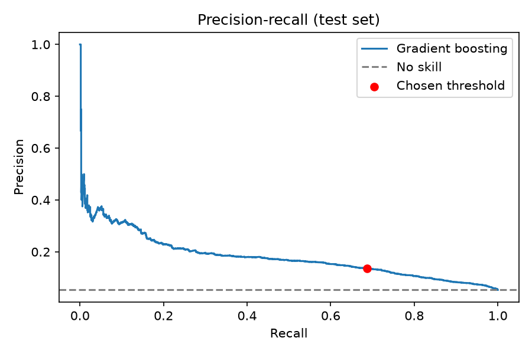
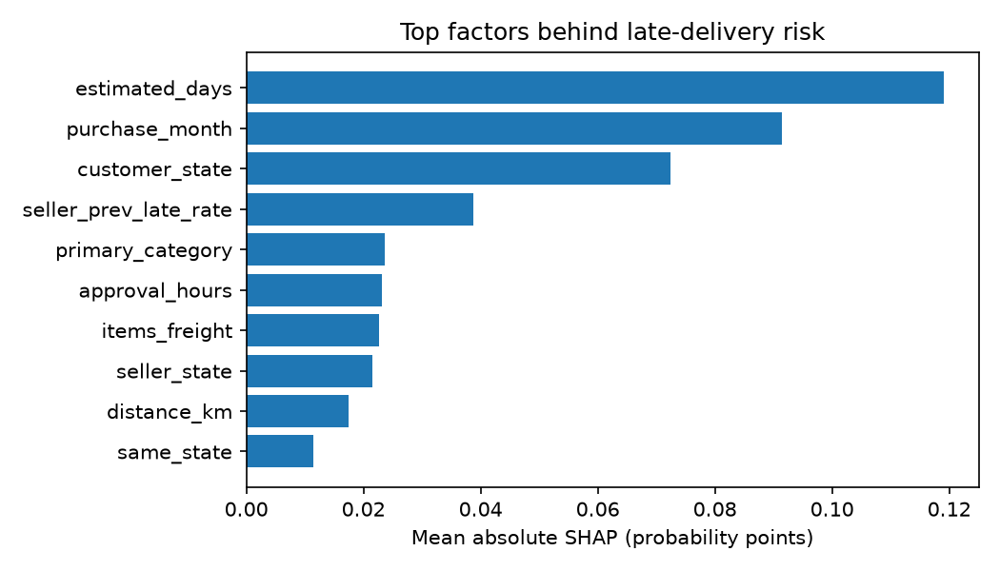

# Olist Delivery Risk: Data Pipeline and Prediction

End-to-end analytics project on the Olist Brazilian e-commerce dataset: DuckDB + dbt pipeline, a late-delivery prediction model, a FastAPI service and a Next.js dashboard.

Status: in progress.

## Results

**Task:** predict whether an order will arrive after its estimated delivery date, using only information known at purchase time.

**Validation:** time-based split. The model trains on 77,180 orders up to 26 May 2018 (8.8% late) and is tested on 19,296 later orders from 26 May to 29 Aug 2018 (5.3% late). The seller delay-history feature only counts orders that were already delivered before each purchase, so there is no leakage of future information.

| Model | PR-AUC | ROC-AUC |
|---|---|---|
| No skill (always guess the late rate) | 0.053 | 0.500 |
| Logistic regression (baseline) | 0.107 | 0.712 |
| Gradient boosting | 0.181 | 0.788 |

**Decision threshold:** chosen on a validation slice (not the test set) to reach recall of at least 0.5. On the test set it flags 26.8% of orders and catches 702 of the 1,021 late ones (recall 0.69, precision 0.14), about 2.6 times better than picking orders at random.

### What drives late deliveries

SHAP values on a 200-order sample rank these as the strongest factors: the promised delivery window (`estimated_days`), purchase month, customer state, and the seller's recent delay history. Freight cost, approval time, product category and seller-to-customer distance each add smaller effects.

### Limitations

- Precision is modest: about 1 in 7 flagged orders is truly late. The model is best used to prioritise which orders to review, not to make automatic decisions.
- The score is a risk ranking, not a true probability, because the model is trained with balanced class weights.
- The late rate fell over time (9.2% in training, 5.3% in test), so the threshold would need regular re-checking on new data.
- Purchase month may reflect specific congested periods in a two-year window, not a general seasonal rule.
- SHAP values come from a 200-order sample, so the top factors are reliable but the order of the smaller ones may shift.
- About 0.5% of orders have no seller-to-customer distance because of missing coordinates; the model fills these in.

## How to run it

1. Create the environment: `python3.12 -m venv .venv`, then `source .venv/bin/activate`, then `pip install -r requirements.txt`.
2. Download the Olist dataset from Kaggle (Brazilian E-Commerce Public Dataset by Olist) and unzip the CSV files into `data/raw`.
3. Load the raw data: `python scripts/load_raw.py`.
4. Build and test the dbt models: `cd dbt_olist`, then `dbt run`, then `dbt test`, then `cd ..`.
5. Train the model and score all orders: `python ml/train_model.py`, then `python ml/score_orders.py`.
6. Start the API: `uvicorn api.main:app --reload`, then open `http://127.0.0.1:8000/docs`.
7. Run the tests: `python -m pytest`.

### API endpoints

- `GET /health`: health check.
- `GET /kpis`: dashboard numbers (on-time rate, average review score, orders by state).
- `GET /high-risk?limit=20&state=SP`: the riskiest flagged orders in the test period.
- `POST /predict`: risk score and top reasons for a single order.
